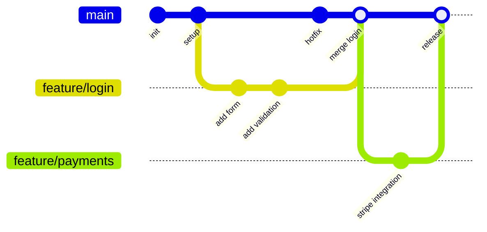
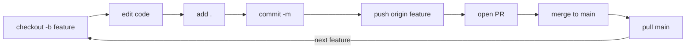

# Git cheat sheet

## 🌳 Branch model



---

## 🔁 Everyday flow



---

## 📦 Basics

| Command | What it does |
|---|---|
| `git clone <url>` | Copy a remote repo locally |
| `git status` | See staged / unstaged / untracked files |
| `git add .` | Stage all changes |
| `git add <file>` | Stage a specific file |
| `git commit -m "msg"` | Commit staged changes |
| `git commit --amend` | Edit the last commit |
| `git log --oneline --graph` | Compact commit history |
| `git diff` | Show unstaged changes |

## 🌿 Branching

| Command | What it does |
|---|---|
| `git branch` | List local branches |
| `git checkout -b <name>` | Create + switch to new branch |
| `git checkout <name>` | Switch branch |
| `git branch -d <name>` | Delete a merged branch |
| `git branch -D <name>` | Force delete a branch |
| `git merge <name>` | Merge branch into current |
| `git rebase <name>` | Reapply commits on top of another base |

## ☁️ Remote & sync

| Command | What it does |
|---|---|
| `git fetch` | Download remote changes (no merge) |
| `git pull origin <branch>` | Fetch + merge from remote |
| `git push origin <branch>` | Push commits to remote |
| `git push -u origin <branch>` | Push + set upstream tracking |
| `git remote -v` | List remotes |

## ⏪ Undo & recover

| Command | What it does |
|---|---|
| `git reset --soft HEAD~1` | Undo last commit, keep changes staged |
| `git reset --hard HEAD~1` | Undo last commit, discard changes |
| `git checkout -- <file>` | Discard local changes to a file |
| `git revert <hash>` | Create new commit that undoes a commit |
| `git stash` | Shelve current changes |
| `git stash pop` | Reapply shelved changes |
| `git cherry-pick <hash>` | Apply a specific commit onto current branch |

## 🏷️ Tags

| Command | What it does |
|---|---|
| `git tag v1.0.0` | Tag current commit |
| `git push origin v1.0.0` | Push a single tag |
| `git push --tags` | Push all tags |

---

### 💡 Muscle-memory sequence

```
checkout -b  →  add  →  commit  →  push  →  PR  →  pull main
```